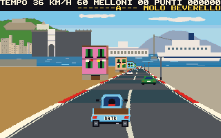
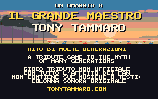
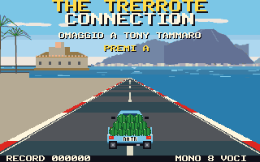
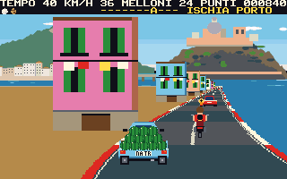
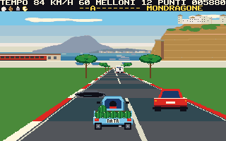
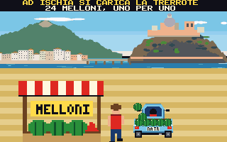
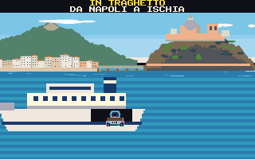

# The Trerrote Connection

**A tribute game for the myth of many generations: il Grande Maestro Tony Tammaro.**

Tony Tammaro is the Neapolitan singer-songwriter who, since his *Prima cassetta di musica tamarra* in 1989, has
made several generations laugh at, and with, the tamarri. This game is a homage to him and to that world, for the
[PRG32](https://github.com/riscv-prg32/PRG32) RISC-V console. Enjoy the tamarro vibes!

> **This is an unofficial tribute**, made by fans with affection. It was not made, endorsed or reviewed by Tony
> Tammaro, and it contains none of his music, lyrics, recordings or images. The soundtrack is original. His official
> site is [tonytammaro.com](https://www.tonytammaro.com). See [docs/originality.md](docs/originality.md).



You drive a Trerrote, the three-wheeled Ape Car, and you deliver watermelons.

| | Leg | What it asks of you |
|---|---|---|
| 1 | **Villa Comunale → Molo Beverello**, Naples | Beat the traffic jam and catch the ferry to Ischia |
| 2 | **Ischia**, loaded with 24 melons, down to the port | Narrow lanes and many turns: take them too fast and the melons leave |
| 3 | **Pozzuoli → Torregaveta** | Deliver to the stalls, past *la monnezza della gente* |
| 4 | **Torregaveta → Mondragone** | Potholes, tamarri, and the mozzarella truck |
| 5 | **Mondragone → Baia Domizia** | All of it at once, with the sun going down |

**A melon that falls keeps going.** Hit something and the Ape stops but the melon flies on along the road. Drive over
it to get it back, before a passer-by or another car does. The horn scatters the thieves, and sometimes even moves the
car in front. Along the way, pick up what Patrizia ordered, in order: **mozzariella, provola, ricotta, caciotta** and
a **frittatina di maccheroni**. She is waiting at Baia Domizia, and she is hungry.

| | |
|---|---|
|  |  |
|  |  |
|  |  |

On screen the game speaks Italian, as it should.

## Controls

| Input | Action |
|---|---|
| Joystick left / right | Steer |
| A | Accelerate |
| B or joystick down | Brake |
| Joystick up | Horn |
| START | Pause; on the title, the high scores |

In QEMU: `w a s d`, `j` for A, `k` for B, and Enter.

## What it shows off

- **Eight-bit indexed colour:** every row reaches the firmware as an indexed sprite, with exact palettes solved against the firmware's quantiser: up to 64 colours per screen.
- **Seven views of the real places**, painted by code: Castel dell'Ovo and Vesuvius, the Maschio Angioino, the Castello Aragonese, the Serapeum of Pozzuoli, the tuff of Torregaveta, Monte Petrino, the pines of Baia Domizia. About 2.5 KB each.
- **A pseudo-3D road in a 64 KiB cartridge:** a row compositor that holds one row in memory, not one frame. Nothing is ever erased, so nothing flickers.
- **Eight SID-like voices:** an original soundtrack in the manner of Neapolitan cassette pop, stereo effects that follow the action, and an engine that coughs like a two-stroke. It plays in mono on the default firmware and in stereo on an Audio Plus build.
- **Evidence:** millions of test checks, a repaint test of the renderer, a Monte Carlo balance study, and a build meant to reproduce byte for byte.

## Status

Runs on a physical ESP32-C6, on the PRG32 firmware under QEMU and on the PRG32-QT core, and passes the Cartridge Store's own ingestion check. On the board it runs at about 17 frames per second in play. **It has not been played by people, the whole journey has not been driven on the board, and nobody has heard the soundtrack.** See [docs/testing.md](docs/testing.md).

The Store bundle is `dist/the-trerrote-connection-1.0.1-store.zip`. It has not been submitted. See [docs/store_publishing.md](docs/store_publishing.md).

## Build

With [PRG32](https://github.com/riscv-prg32/PRG32) as a sibling checkout and the ESP-IDF RISC-V toolchain installed:

```bash
tests/run_tests.sh
```

```bash
scripts/build.sh && scripts/pack-store-bundle.sh
```

Full instructions: [docs/reproduce.md](docs/reproduce.md).

## Documentation

Start at [docs/index.md](docs/index.md).

## License

The code and original assets are MIT. See [LICENSE](LICENSE) and [CITATION.cff](CITATION.cff). The MIT license covers this game only: it grants nothing over Tony Tammaro's name or work.
