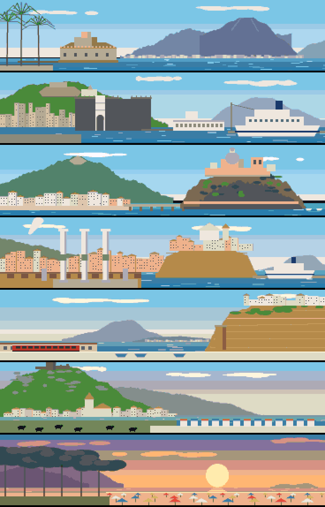
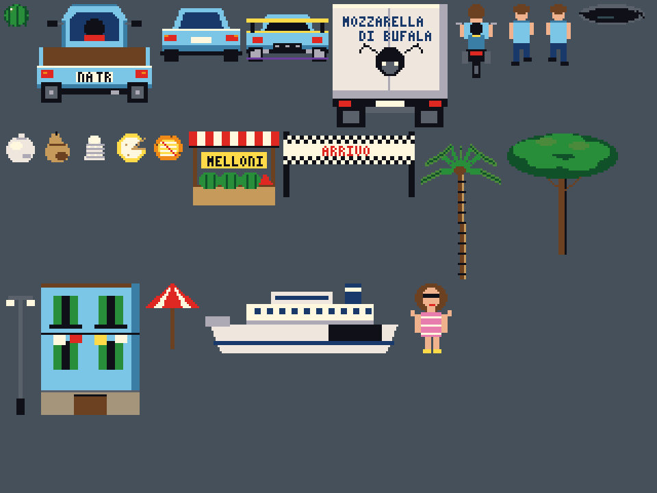

# Art

Every picture is produced by the code in `tools/art_scenes.py` and `tools/art_sprites.py`. **The views are not
photographs, nor traced from any.** They are compositions from the known form of each landmark, written from general
knowledge. They were not compared against reference photographs or surveyed viewpoints, so their arrangement is
faithful in spirit and not exact: someone from Pozzuoli will spot liberties. The light moves through the day along
the journey, from morning in Naples to sunset at Baia Domizia.

| View | Landmarks painted |
|---|---|
| Villa Comunale | Palms and railing of the Villa, Castel dell'Ovo on its islet, Vesuvius with the Somma ridge and the Gran Cono, the towns at its foot |
| Molo Beverello | Castel Nuovo with dark towers and white arch, the Vomero with Sant'Elmo and the Certosa, Stazione Marittima, a ferry, Vesuvius in the haze |
| Ischia | Castello Aragonese on its rock with the dome, the Ponte Aragonese, Ischia Ponte's pastel houses, Monte Epomeo |
| Pozzuoli | The three columns of the Macellum (the "Temple of Serapis") with their bands of mollusc borings, Rione Terra and the Duomo, the port, Capo Miseno, fumes from the Solfatara |
| Torregaveta | The layered tuff of Monte di Procida, the old coastal tower, the red Cumana train, Procida and Epomeo on the horizon |
| Mondragone | Monte Petrino and its ruined Rocca, the town, the lidos, and the buffalo of the plain |
| Baia Domizia | Umbrella pines, rows of beach umbrellas, a sunset over the sea (this coast faces west), Monte Massico and Roccamonfina inland, Ponza on the horizon |

Sprites: `assets/png/sprites.png`.

Foods are drawn to be told apart at 16 pixels: the mozzarella's knot, the provola's pear shape, the ricotta's basket
marks, the caciotta's wedge, the frittatina's split showing the pasta.
